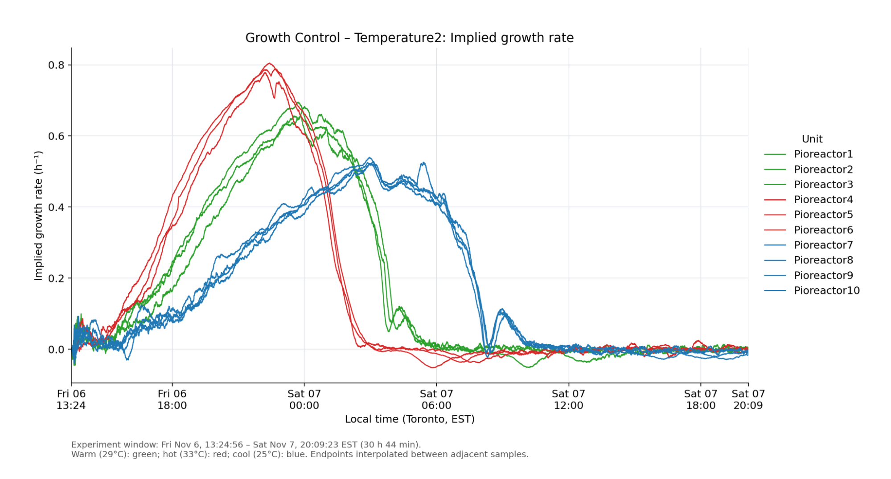
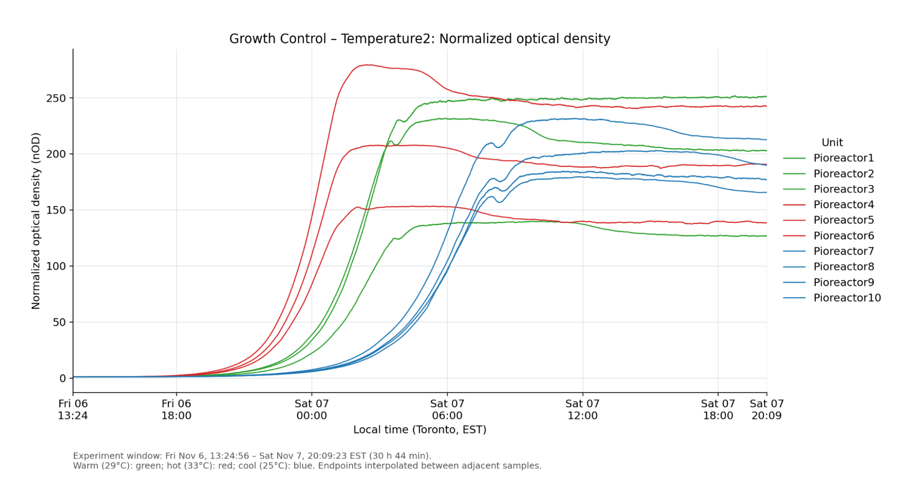
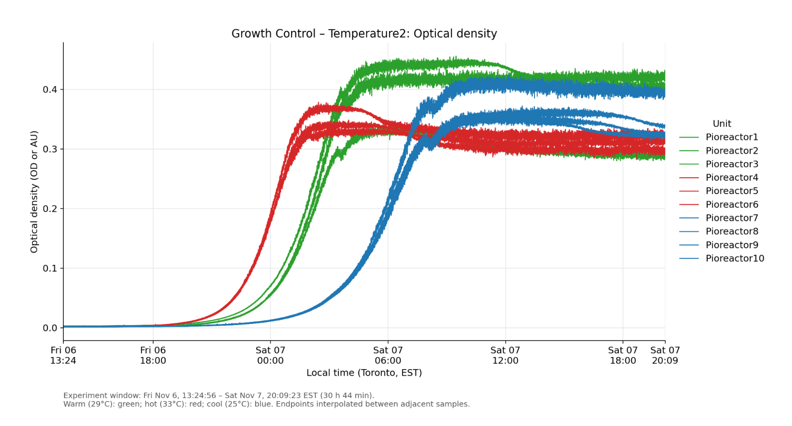
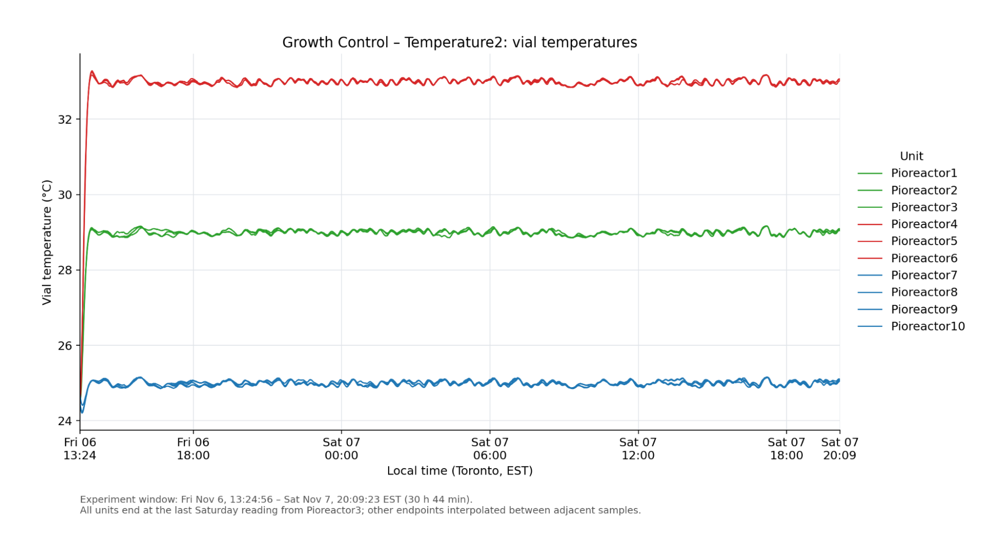

import AssemblyInstructionBlock from '@site/src/components/AssemblyInstructionBlock';

:::tip Success Goal
Determine how temperature affects the growth rate of baker's yeast.
:::

## Introduction

Temperature affects how quickly yeast cells reproduce and use nutrients. In this experiment, we used Pioreactors to compare yeast growth at **25°C, 29°C, and 33°C**.

Encourage students to choose their own temperatures and predict what will happen. At cooler temperatures, growth may take longer than 24 hours to observe. Use the growth curves to evaluate their predictions and discuss how temperature affects doubling time.

:::info
The Pioreactor heats cultures but does not actively cool them. Choose temperatures at or above ambient temperature, or use an externally cooled environment. Keep the electronics dry.
:::

## Materials

<AssemblyInstructionBlock images={["experiments/02-secondary-level-education/yeast-growth-by-temperature/temperature-experiment-materials.jpg"]}>

- 40 mL Pioreactors (ten were used for the results below)
- Glass culture vials, including one extra vial for yeast stock
- Dry baker's yeast
- YPD broth powder (50 g per litre of distilled water)
- Distilled water
- Erlenmeyer flask
- Autoclave
- Thermometer
- Stir bars
- Scale capable of weighing 0.002 g, or supplies to prepare a larger yeast stock
- Pipette and sterile tips for transferring 1,000 µL (1 mL)

</AssemblyInstructionBlock>

## Procedure

### Prepare the cultures

1. Mix 12.5 g YPD broth powder with 250 mL distilled water in an Erlenmeyer flask.
2. Dispense 19 mL into each experimental culture vial and 20 mL into an additional vial for the yeast stock. Include a stir bar in each experimental vial.
3. Autoclave for 15 minutes at 121°C, then allow the broth to cool to 25–30°C. Alternatively, prepare and autoclave the broth the day before, refrigerate it, and warm it to 25–30°C in a water bath before use.
4. Record the broth temperature when adding the yeast. Add 0.002 g dry baker's yeast to the stock vial containing 20 mL YPD broth.
5. Mix the stock by pipetting until the yeast is fully suspended, rather than shaking the vial.
6. Using sterile technique, add 1,000 µL (1 mL) yeast stock to each experimental vial containing 19 mL YPD broth. Mix the stock between transfers to keep the inoculum consistent.
7. Wipe the outside of each vial and place it in its Pioreactor.

### Media and inoculum calculations

Prepare YPD at **50 g/L**. For a 250 mL batch:

**50 g/L × 0.250 L = 12.5 g YPD powder.**

Each experimental culture starts with **19 mL YPD broth + 1 mL yeast stock = 20 mL**. Set aside another 20 mL of broth to prepare the stock. A 250 mL batch is enough for eleven cultures plus the stock vial, with some broth left over for handling losses.

For the yeast stock, suspend **0.002 g (2 mg) dry yeast in 20 mL YPD broth**.

This makes enough yeast stock for **19 experiments**. Each culture receives **1 mL** of this stock in **19 mL** of YPD broth, for a final volume of **20 mL**.

:::tip Weighing small amounts
If your scale cannot accurately weigh 0.002 g, scale up both the yeast mass and stock volume by the same factor. Keep the concentration the same: a starting culture that is too dense can obscure the growth curve.
:::

### Start the experiment

1. Open [pioreactor.local](http://pioreactor.local) and create a new experiment. Assign the Pioreactors you will use; see [creating a cluster](/user-guide/create-cluster) if needed.
2. On the _Pioreactors_ page, select _Control all Pioreactors_ and start _Stirring_ and _OD reading_. Use the same stirring settings for all cultures.
3. Select _Control_ for each Pioreactor. Start _Temperature automation_ using _Thermostat_ and set its assigned temperature.
4. Confirm that optical density readings and temperatures appear on the _Overview_ page, then start _Growth rate_ for all Pioreactors.
5. Record for at least 24 hours, extending the run if cooler cultures are still growing. The example below ran for approximately 31 hours. Compare the growth rate, optical density, and temperature charts.

## Our experiment

Ten cultures were grown at three temperatures, with multiple Pioreactors at each temperature:

| Pioreactors | Number of cultures | Stir rate | Temperature | Graph colour |
| --- | --- | --- | --- | --- |
| Pioreactor7–Pioreactor10 | 4 | 300 rpm | 25°C | Blue |
| Pioreactor1–Pioreactor3 | 3 | 300 rpm | 29°C | Green |
| Pioreactor4–Pioreactor6 | 3 | 300 rpm | 33°C | Red |

The recorded experiment window was November 6–7, lasting approximately **30 hours and 44 minutes**.

### Growth rate

The cultures at 33°C reached higher peak growth rates earlier than those at 29°C. The cultures at 25°C grew more slowly and reached their peak later.

### Optical density

The optical density curves show the same progression: the 33°C cultures increased first, followed by 29°C and then 25°C. Compare replicates as well as temperature groups when interpreting the curves.

### Temperature during the experiment

## Conclusions and discussion

Within the tested range, a higher temperature promoted faster yeast growth, while a lower temperature slowed it. All three temperature groups grew, but their growth rates and timing differed. These results do not establish the optimum temperature or show what happens beyond the tested range.

Ask students to consider:

- Which temperature produced the highest growth rate? Which cultures took longest to reach a plateau?
- How consistent were the cultures grown at the same temperature?
- Does faster growth always mean a higher final optical density?
- How would they design a follow-up experiment using other temperatures?
