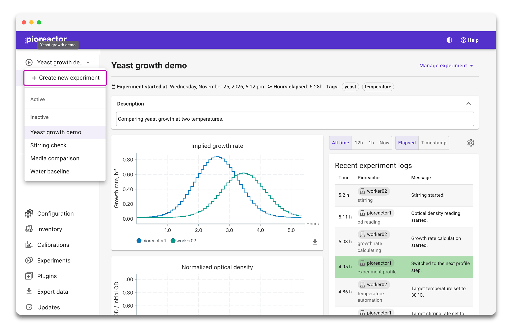
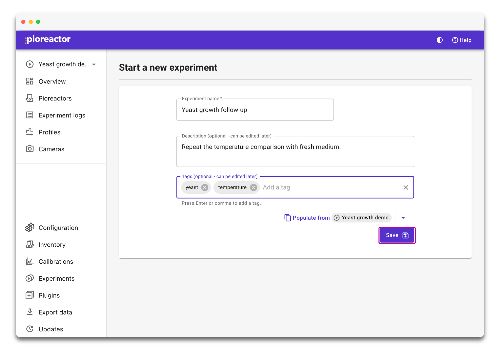
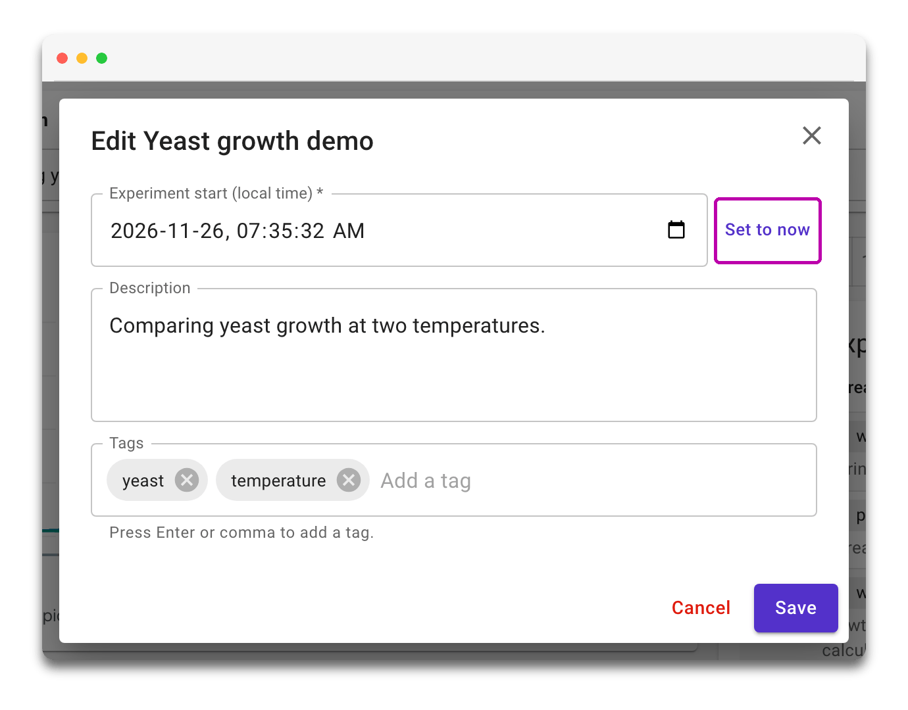
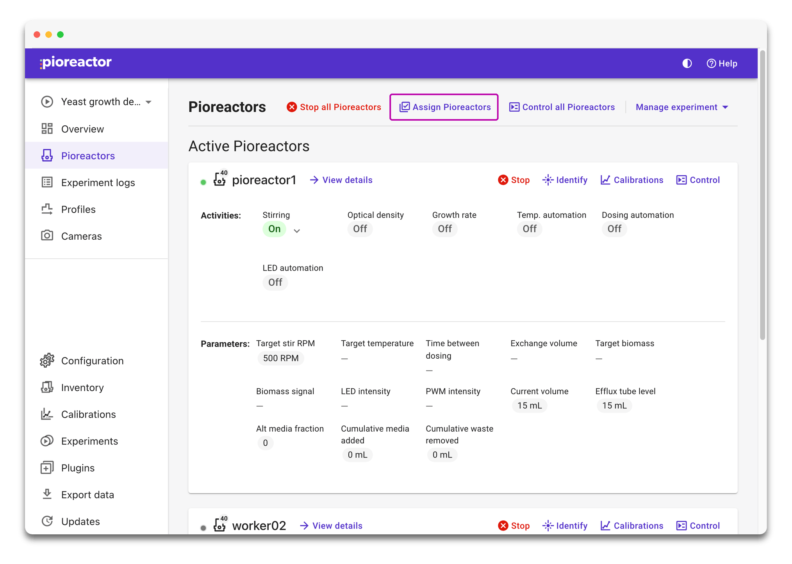
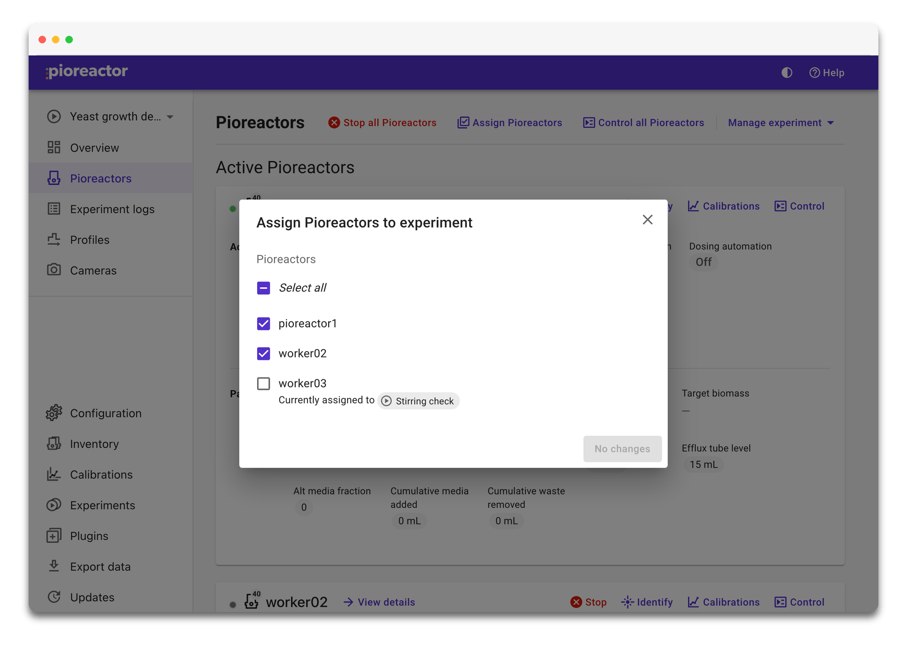
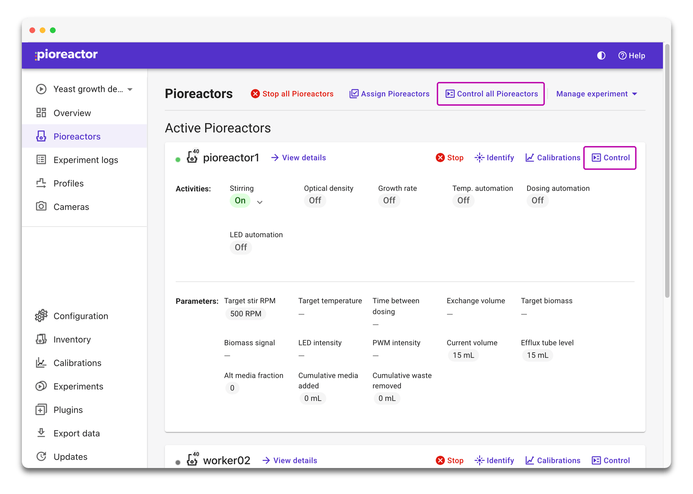
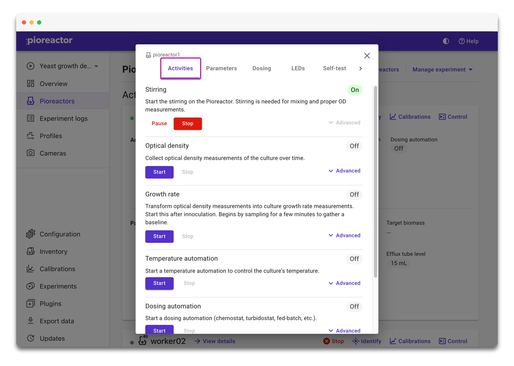
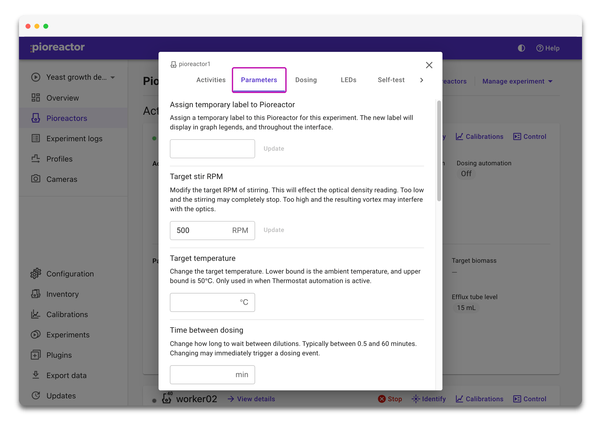
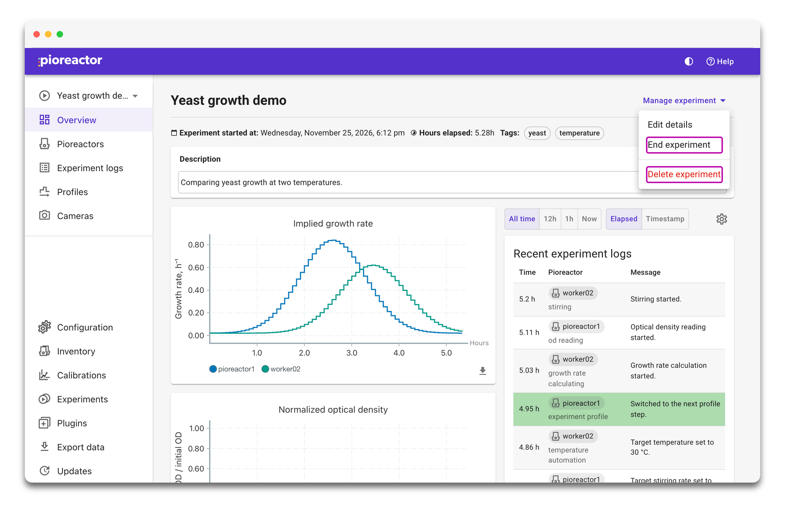

import AssemblyInstructionBlock from '@site/src/components/AssemblyInstructionBlock';
import Highlight from '@site/src/components/Highlight';
import Admonition from '@theme/Admonition';

### Creating an experiment

To create your first experiment, open the experiment selector in the top-left corner of the UI and choose **Create new experiment**. This appears as the first item in the dropdown above your other experiments.

On **Start a new experiment**:

1. Enter a unique experiment name.
2. Optionally add a description. This can be edited later.
3. Optionally add tags. Press `Enter` or type a comma after each tag to save it.
4. To reuse setup details, choose a previous experiment from the arrow menu beside **Populate from**, then click **Populate from [experiment name]**. This fills in its name, description, and tags; change the name to a unique one before saving.
5. Click **Save**.

Tags are useful for grouping related experiments across time. For example, you might tag experiments by strain, media, operator, protocol, or project name.

After saving, you can come back to the experiment later from **Experiments**.

Use **Edit details** to change the experiment start time, or **Set to now** to match time zero to inoculation. Charts, elapsed times, and media-rate summaries use this start time and exclude earlier readings. Changing it does not delete data.

### Assigning Pioreactors to your experiment

The **Pioreactors** tab displays the active and inactive Pioreactors assigned to the current experiment. Click **Assign Pioreactors** to choose which Pioreactors belong to this experiment.

You can run different experiments at the same time by assigning different Pioreactors to each experiment. For example, one experiment can use `worker01` and `worker02` while another experiment uses `worker03`.

In the assignment dialog, a Pioreactor that is already assigned to another experiment is shown with that experiment name. Selecting it will unassign it from the other experiment and assign it to the current one.

Unassigning a Pioreactor from an experiment stops its activities for that experiment. This applies whether you unassign it from the **Pioreactors** tab, reassign it to another experiment, or end the experiment.

## Start activities from the Pioreactors page

On the **Pioreactors** page, look under **Active Pioreactors**. Click **Control** on a card and open **Activities** to start, pause, resume, or stop an [activity](/user-guide/activities). Use **Control all Pioreactors** to manage activities across the active units assigned to the experiment.

The typical sequence of activities to start is:

1. **Stirring**
2. **Temperature automation**, and selecting **Thermostat**
3. **Optical density**
4. After observing that the optical density looks normal on the _Experiment Overview page_, **Growth rate**
5. Any other activities. Any of the automations can be started, or [custom jobs](/user-guide/using-community-plugins) you've added to your Pioreactor.

## Changing settings

If you'd like to **change the settings** of your activities after you start, return to **Pioreactors**. Click a value in a Pioreactor card to edit it directly. For example, use **Target stir RPM** in the **Parameters** row to adjust stirring.

You can also open **Control** for one Pioreactor or **Control all Pioreactors**, then click **Parameters**.

Here you can change the settings of your activities (such as temperature, RPM, and dosing volume) without pausing or stopping the activity.

To add an experiment-specific label, click the unit name on its Pioreactor card. You can change the label there at any time.

:::tip
Use these labels to keep track of treatments on multiple Pioreactors. For example, labels '15C', '25C' and '35C' can be used to differentiate temperature treatments. These labels will be shown on graphs generated in the _Overview_ page on the website.
::: 

#### Ending your experiment

Open **Manage experiment** near the top of **Overview**, **Pioreactors**, or **Profiles**.

**End experiment** stops all running activities and unassigns all Pioreactors from the experiment.

:::warning
The option _Delete experiment_ will do the same, while also deleting all experiment data. Note that you will not be able to export any data from a deleted experiment. 
:::
