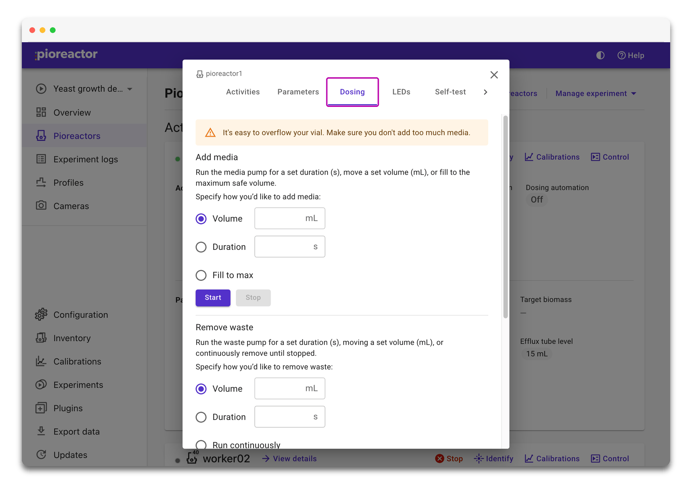
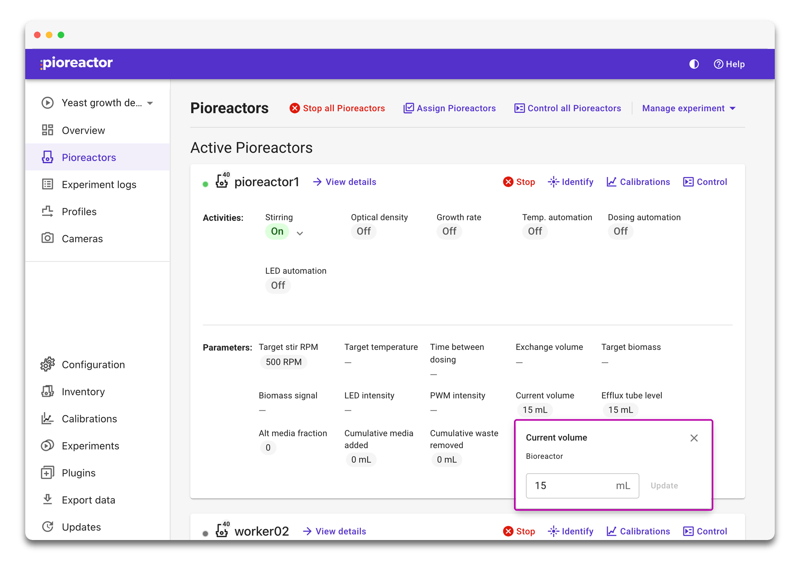
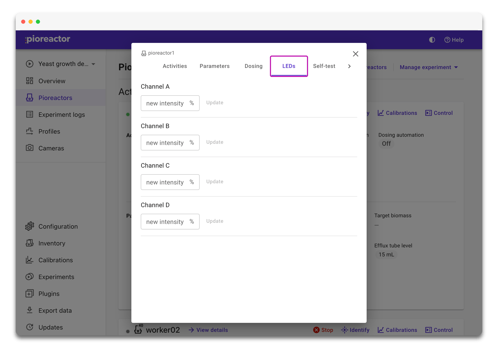

### Dosing

You can run the pumps from the Pioreactor UI. These are not automations, but simple actions used to set up an experiment, perform cleaning, or intervene mid-run. For automated workflows, see [dosing automations](/user-guide/dosing-automations).

#### Specific control of pumps

Open **Control** on the Pioreactor card, then choose **Dosing**. Choose **Duration** or, for a calibrated pump, **Volume**. For media and alt-media, **Fill to max** runs the pump up to the estimated safe fill limit. For waste, **Run continuously** runs until you click **Stop**. Read more about [using pumps](/user-guide/using-pumps).

:::caution
Careful not to overflow your vial! The Pioreactor estimates liquid volume from its recorded starting volume and dosing events. Check the estimate before running a pump and stay below the vial’s maximum fill volume.
:::

#### Adjustments from manual changes

Sometimes you may want to add or remove liquid from the vial by hand, for example when taking a sample. After the manual change, go to **Pioreactors** and click the value under **Current volume** on that Pioreactor’s card. This updates the estimated liquid volume without running the pumps.

For example, if you remove 0.2 mL from a vial that currently shows 14 mL, change **Current volume** to 13.8 mL.

----

### LEDs

Open **Control → LEDs** to set the intensity of each LED channel. For automated light schedules, see [LED automations](/user-guide/led-automations).

