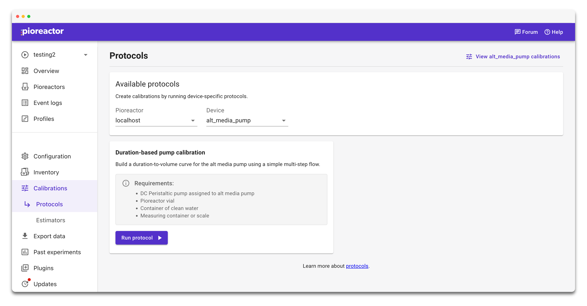

Protocols are step-by-step workflows for calibrations. Use the Protocols page in the UI to run a calibration protocol, enter the required metadata, and follow the guided prompts.

## Run a calibration protocol

1. Open **Protocols** from the left navigation.
2. Choose the protocol that matches your calibration goal.
3. Enter a clear name and any metadata requested by the flow.
4. Follow the on-screen steps to collect measurements.
5. At the review step, check the recorded points and fitted curve. Correct entered values or uncheck points to exclude them, then select **Update chart** to refit before saving.
6. Save the calibration and set it active if needed.

Review is available for OD600 standards, duration-based pump, DC-based stirring, and fusion OD protocols. Stirring calibrations run on all Pioreactors at once keep every reading; CLI calibrations save as before.

The available protocols depend on connected hardware and the calibration type you select. For optical density calibrations, see [Standard curves for OD600 readings](/user-guide/calibrate-od600).
