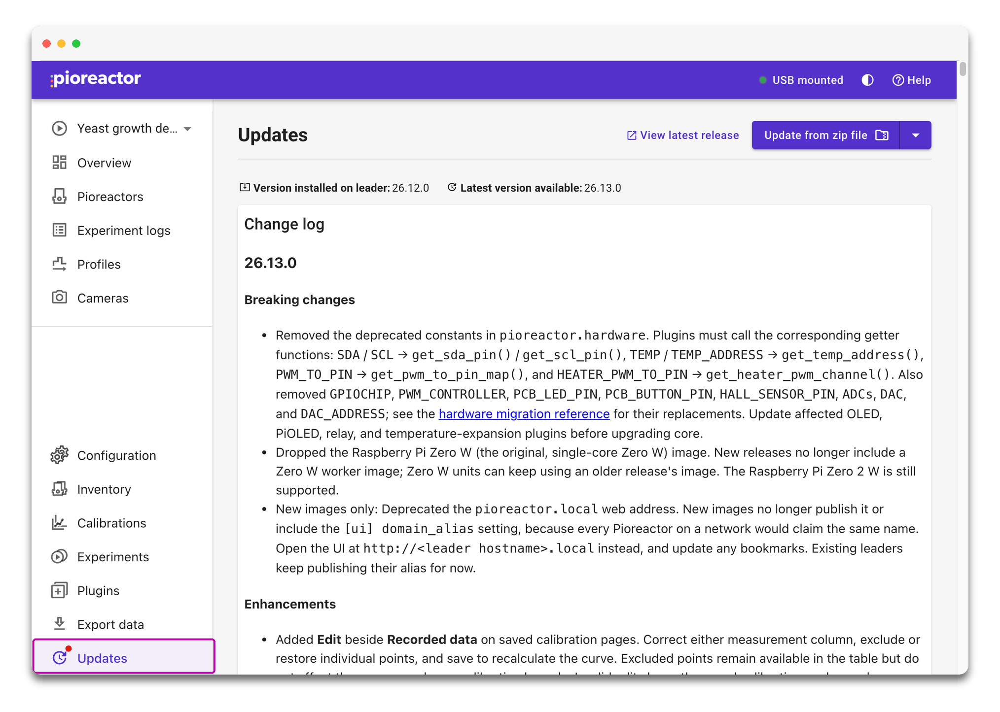
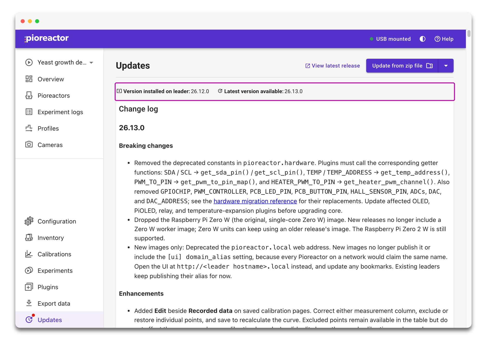
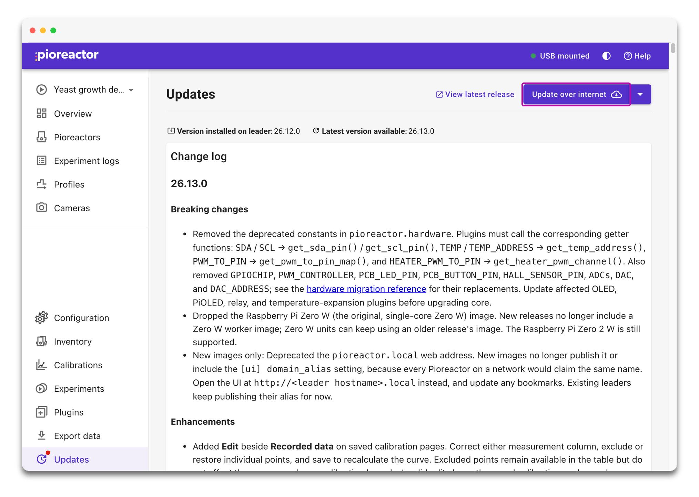
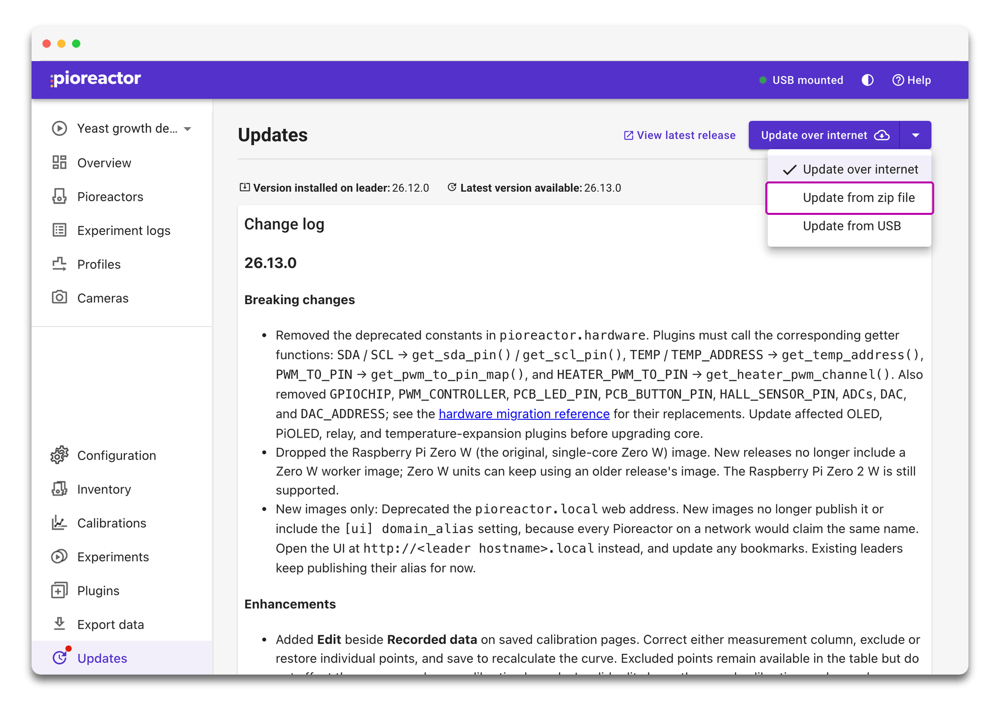
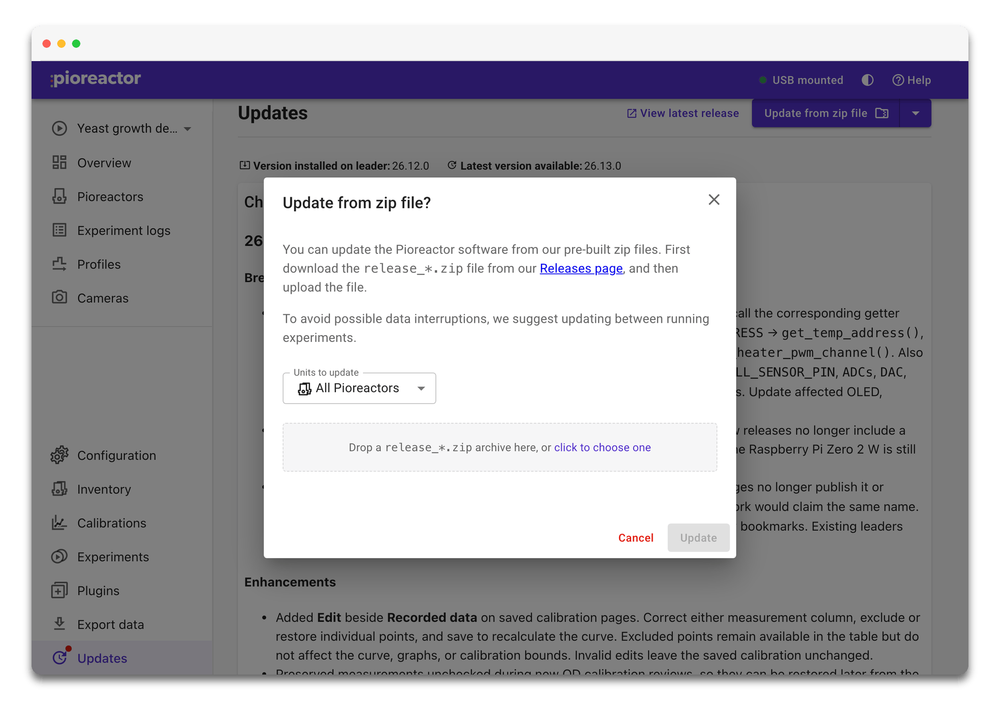
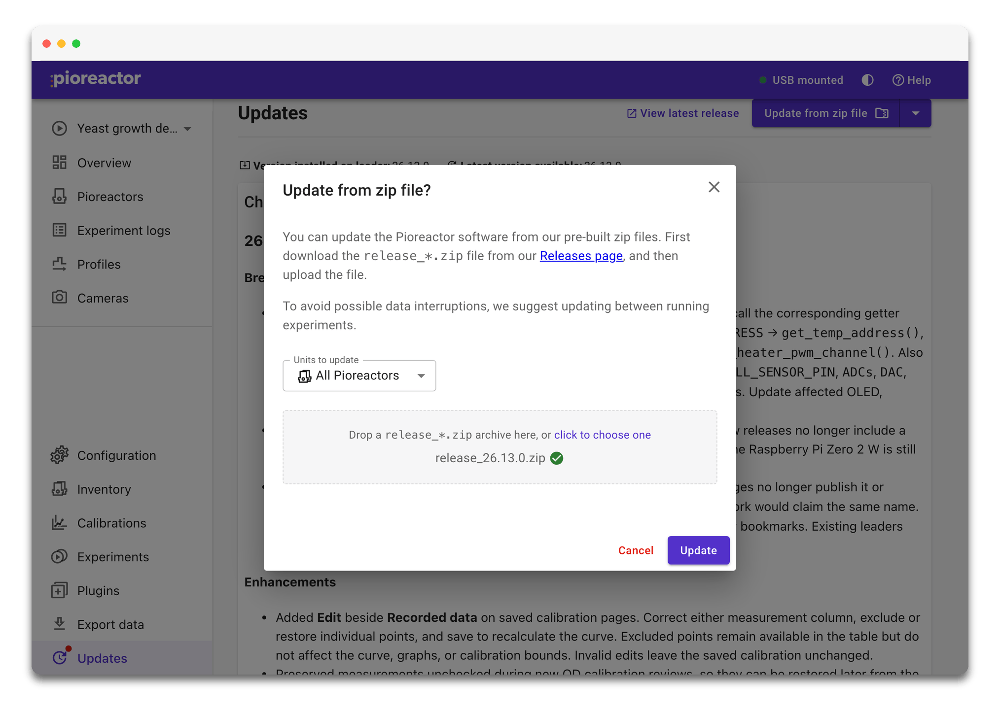
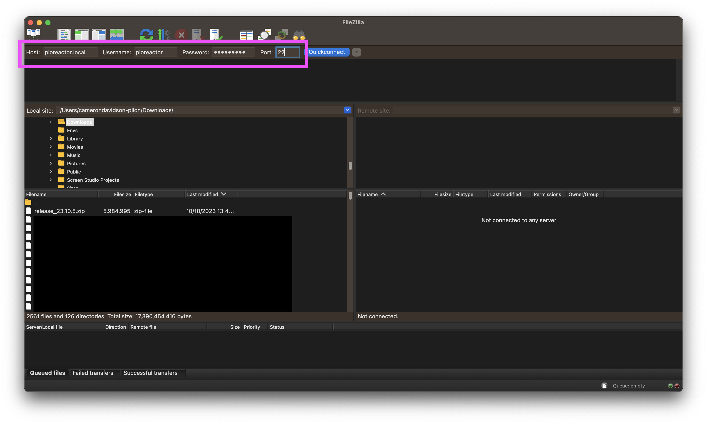
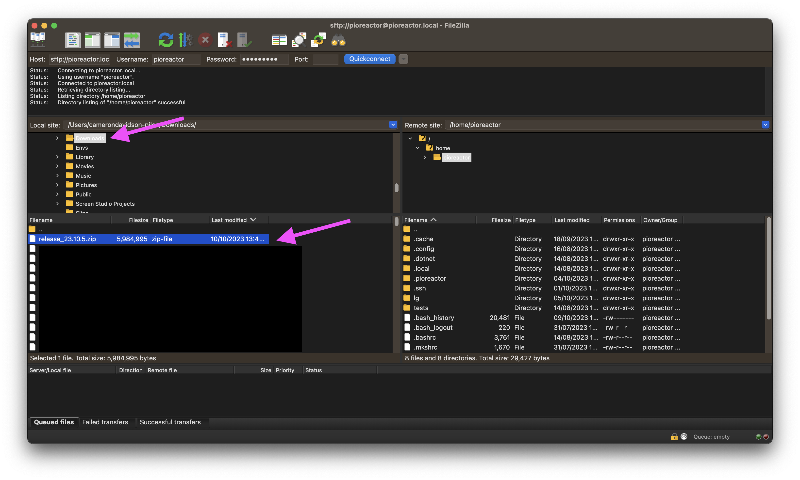
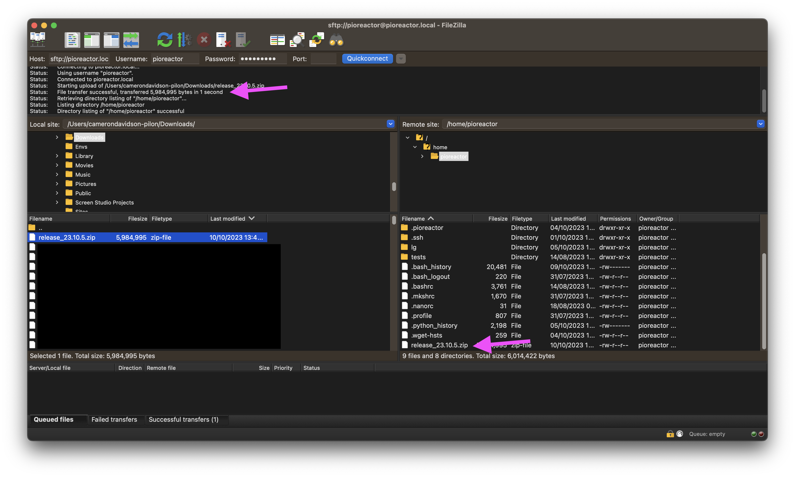

import ButtonDownloadVersionedReleaseZip from '@site/src/components/ButtonDownloadVersionedReleaseZip';


We publish new software occasionally that fixes bugs, adds new features, and improves performance. You can update your Pioreactor(s) to the latest software from the UI, or from the command line. **We highly recommend keeping your Pioreactor software up to date!**


### Method 1: Updating over the internet

:::info
To use this update method, you Raspberry Pi must be able to access the internet. Using a local access point, see method 2 below.
:::

When an update is available, a red dot appears beside **Updates** in the sidebar.



On the **Updates** page, you can see what version you have installed, and the latest version published by us. You can also read the changelog to see what improvements we've made in the latest releases.

If a release mentions Turbidostat biomass signal selection changes, see [Dosing automations](/user-guide/dosing-automations) for the current `biomass_signal` behavior, override options, and migration notes.




Open the dropdown in the top right and select **Update over internet**. Click **Update over internet** to open the confirmation dialog. Update between experiments to avoid interrupting data collection.



In the confirmation dialog, choose **All Pioreactors** or one unit, then click **Update**.

:::note

A cluster can be on mixed software versions temporarily while a rolling update is in progress. Version skew may expose incompatible features or APIs, so complete the update across the cluster. Adding a worker requires it to run the same software version as the leader. Update workers before changing their models through the leader.

For the 26.11.0 upgrade, update the leader and all workers together, then reload browser tabs: PWM MQTT topics and bioreactor value payloads have changed. See [MQTT payloads](/developer-guide/mqtt#bioreactor-values-and-pwm-duty-cycles) if you maintain plugins, scripts, or experiment profile expressions that consume these values.

:::

:::info

The updating process will update to the _next_ release, after your current version. So if your current version is 23.4.1, and there are _two_ more recent releases, say 23.5.1 and 23.6.1, then the update process will update to 23.5.1. You can run the update process _again_ to update to 23.6.1. We do this so that you will get changes folded in from each release we make.

:::

#### Installing previous versions or development versions

You can install the bleeding-edge software from this page as well. Just select the development build in the drop down. Warning: this version may be unstable (and fun!)

Similarly, from the [command line](https://docs.pioreactor.com/user-guide/accessing-raspberry-pi), you can install specific versions. See `pio update app --help` for more.


### Method 2: Update using a zip file and the UI


Each time we release a new Pioreactor version, we create a bundle of the required files as a zip file. This zip file can be uploaded to your Pioreactor cluster via the UI.

:::info

We highly recommend updating incrementally. That is, update to the _next_ version, and continue only if it succeeds.

:::

1. Download the release you wish to update to: <ButtonDownloadVersionedReleaseZip/>

2. In the UI, open **Updates**. In the dropdown at the top right, select **Update from zip file**, then click the **Update from zip file** button.



3. Open the file picker using **click to choose one** in the dialog.



4. Select the archive you downloaded (`release_xx.xx.xx.zip`). You can also drop it directly into the dialog.

5. Confirm the filename appears in the dialog, then click **Update**.




### Method 3: Update using a zip file from a USB drive

Download the release you wish to update to: <ButtonDownloadVersionedReleaseZip/>

Copy it to the root of a USB drive, attach the drive to the leader, then choose **Update from USB** on the **Updates** page. See [Update software from USB](/user-guide/using-usb-drives#update-software-from-usb) for the full steps.


### Method 4: Update using a zip file over scp or sftp


1. Download the release you wish to update to: <ButtonDownloadVersionedReleaseZip/>

2. Copy the release archive to your leader Pioreactor. Use either option below.

   **Option A: `scp` on the command line**

   ```
   scp <path to release archive> pioreactor@<leader hostname>.local:/home/pioreactor
   ```

   **Option B: FileZilla**

   1. Download and open [FileZilla](https://filezilla-project.org/download.php?type=client).
   2. Make sure your computer is on the same network as the leader. If you use the leader's local access point, connect to the _pioreactor_ Wi-Fi network first.
   3. Enter the following credentials in the top-right:

      - host: `<leader hostname>.local` (or its IP address)
      - username: `pioreactor`
      - password: `raspberry` (or the password you chose during setup)
      - port: `22`

      Click `Quickconnect`. You should successfully connect to your Pioreactor's Raspberry Pi (and may need to accept a security pop-up).

      

   4. On the left-hand side is your computer's file system. Find the `release_xx.xx.xx.zip` file you downloaded earlier, and double click it to upload to the Raspberry Pi (that filesystem is on the right).
      
   5. You should see a successfully uploaded message, and the file should be present on the right-hand side now. You can close FileZilla.
      

3. [SSH into your leader Pioreactor](/user-guide/accessing-raspberry-pi). Now enter:
   ```
   pio update app --source release_xx.xx.xx.zip
   ```
   (Of course, replace the `xx.xx.xx` with your version). This will kick off a task to update your software.

4. To update your workers, first distribute the release file to all workers:
   ```
   pios cp release_xx.xx.xx.zip -y
   ```

5. Finally, run the following to update the software on the workers:
   ```
   pios update app --source release_xx.xx.xx.zip
   ```
